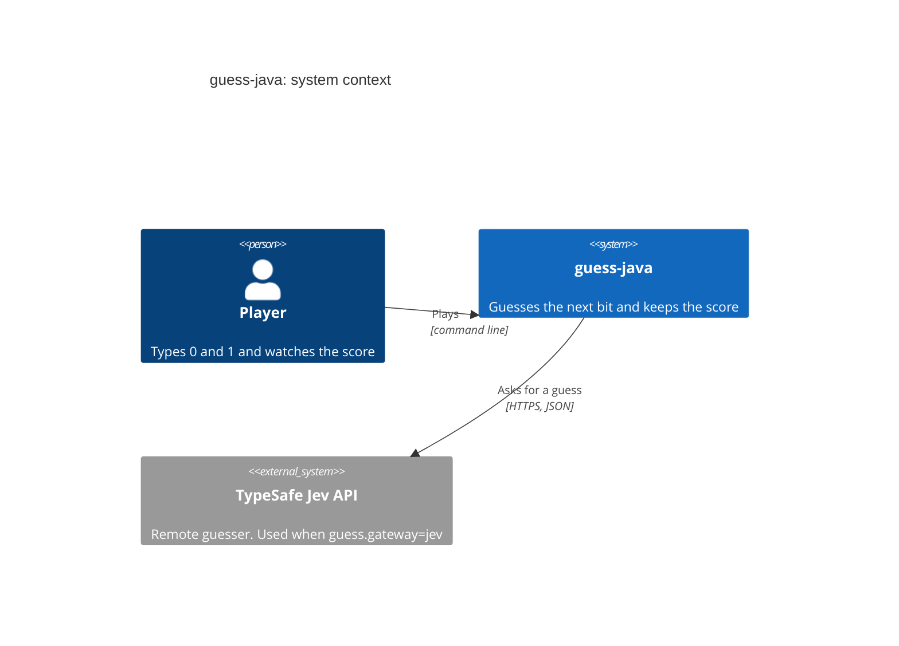
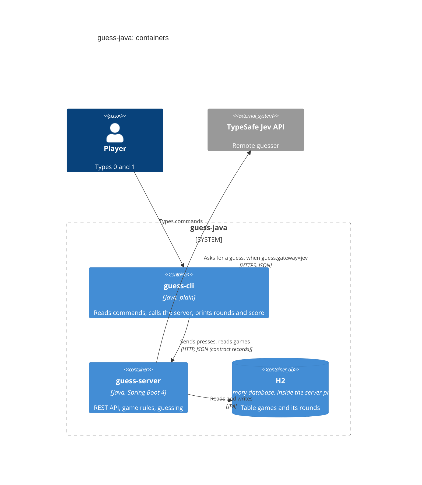
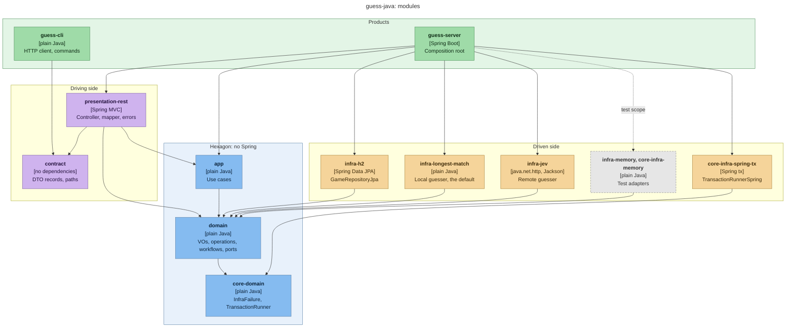

# guess-java

A small guessing game that shows **hexagonal architecture and DDD in Java**.

You send bits (0 or 1). Before each bit, the server guesses it from the last N bits. You "win" by staying unpredictable.

## What this project shows

- Hexagonal layers with Maven modules. A missing dependency is the layer check: if domain code imports Spring, it does not compile.
- DDD building blocks in plain Java: value objects and entities as records, sealed interfaces for variants, checked exceptions as typed domain errors.
- **Spring only at the edges.** The domain and app modules have no Spring. Spring appears in `infra`, `presentation` and `products`.
- **Spring repositories as adapters.** Spring Data JPA and the JPA entity live inside one infra module. A plain adapter class implements the domain port.
- Pure rules (`*Operations`) and side effects (`*Workflows`, static methods, ports as arguments). The workflow owns the transaction.
- Test adapters are real modules (`infra/memory`). There is no Mockito: the build excludes it.
- A shared `contract` module (DTO records and path constants) used by the server and the CLI.

The `.claude/skills/` folder holds the rules as short guides. They are the most useful part of the project.

## Architecture

The code follows the hexagonal architecture. The domain is at the centre and the application layer is around it. Everything else is outside the hexagon and connects to it from one of two sides. Presentation is the driving side: it starts the actions. Adapters are the driven side: the hexagon calls them when it needs the outside world. Dependencies always point inward.

| Layer | Place in the hexagon | Modules |
|---|---|---|
| Products | Outside, wires everything | `guess-server`, `guess-cli` |
| Presentation | Outside, driving side | `presentation/rest` |
| Contract | Outside, the wire format | `contract` |
| Application | Hexagon, outer layer | `app` |
| Domain | Hexagon, centre | `domain`, `core/domain` |
| Adapters | Outside, driven side | `infra/*`, `core/infra/*` |

**Products.** A product is a program you run. It has no game logic. `guess-server` holds the composition root (`GuesserWiring`): the one class that picks a concrete adapter for each port and creates the use cases. `guess-cli` is a plain client. It is not a hexagon: it only sends HTTP requests and prints the answers.

**Presentation.** The REST controller turns HTTP into use case commands and domain results into DTOs. It decides nothing. HTTP status codes live here, in the error handler.

**Contract.** DTO records and path constants, with no dependencies. The server writes these records as JSON and the CLI reads them back. This is the only code the two products share.

**Application.** One use case per command, such as pressing a bit or changing the window size. A use case gets ports in its constructor and calls one workflow. It has no Spring, opens no transaction and makes no decisions.

**Domain.** This layer makes the decisions, and it knows nothing about Spring, HTTP or the database. Value objects and entities are the data, such as a round or a game. Operations are pure rules, such as how the score is counted. Workflows combine those rules with ports; they are static methods that get the ports as arguments, and they own the transaction through the `TransactionRunner` port. Ports describe what the domain needs from the outside world.

**Adapters.** An adapter does the work that a port describes. The repository keeps games in H2 through Spring Data JPA, so the Spring repository is an adapter and nothing more. Gateways make the guess: one computes it on the spot (longest match), another asks the remote Jev service. Each port also has a test adapter in `infra/memory`. To replace an adapter, you write a new one and change the wiring; the domain does not change.

The diagrams follow the [C4 model](https://c4model.com) and stop at the module level.

### Level 1: System context



### Level 2: Containers



The database lives inside the server process and is lost when the server stops.

### Level 3: Modules

Each box is a Maven module. An arrow means "has a compile dependency on".



Some arrows are left out to keep the picture readable:
- `guess-server` also lists `domain`, `core-domain` and `contract` directly.
- `app` tests use `infra-memory`. `domain` tests use `core-infra-memory`; they cannot use `infra-memory`, because that would be a Maven cycle.

### Rules to read the diagrams by

- Dependencies point inward: the domain knows no adapter, no use case, no Spring and no HTTP.
- Nothing points at an adapter except a product. A product is the only place that names a concrete adapter.
- The two products share only `contract`. The CLI does not see the domain, and the server does not see the CLI.
- No arrow leaves the hexagon toward Spring: `app`, `domain` and `core-domain` have no Spring dependency, so a Spring import there does not compile.
- `infra-memory` is grey because only tests use it. It is still a real adapter of the same ports, not a mock.

## Module map

```
core/                              things with no feature owner
  domain/                          InfraFailure, TransactionRunner (port)
  infra/memory/                    TransactionRunnerInMemory (test adapter)
  infra/spring-tx/                 TransactionRunnerSpring (Spring transactions)
features/guesser/                  the one feature
  domain/                          vo, entities, errors, operations, ports, workflows (no Spring)
  app/                             one use case per command (no Spring)
  infra/memory/                    GameRepositoryInMemory, GuessGatewayScripted (test adapters)
  infra/longest-match/             guess by the longest repeated pattern
  infra/jev/                       guess by asking the Jev service over HTTP
  infra/h2/                        GameRepositoryJpa with Spring Data JPA and H2
  contract/                        DTO records and path constants (no dependencies)
  presentation/rest/               controller, mapper, error handler
products/                          the only modules with a main
  guess-server/                    Spring Boot REST server, the composition root
  guess-cli/                       plain Java command line client
```

## Build

Needs Java 25 and Maven.

```bash
mvn verify
```

The first build needs network (Tomcat, Jackson 3, Maven plugins). After that you can work offline: `mvn -q -o verify`.

The build makes two runnable jars:

- `products/guess-server/target/guess-server.jar`
- `products/guess-cli/target/guess-cli.jar`

## Run the server

```bash
java -jar products/guess-server/target/guess-server.jar
```

It listens on port 8080 and keeps games in an in-memory H2 database. The default guesser is `longest-match`.

To guess with Jev instead, set the API key in the environment. Never write a key into a file.

```bash
JEV_API_KEY=<your key> java -jar products/guess-server/target/guess-server.jar --guess.gateway=jev
```

## Run the CLI

The CLI talks to `http://localhost:8080`. Change it with `--server URL` or the environment variable `GUESS_SERVER`.

```
$ java -jar products/guess-cli/target/guess-cli.jar new
game 50785aed-cd80-4856-8c1d-bb6321889bac, window 32
score 0/0 (0%)
$ java -jar products/guess-cli/target/guess-cli.jar press 50785aed-cd80-4856-8c1d-bb6321889bac 0101
round 1: bit 0, no guess | score 0/0 (0%)
round 2: bit 1, guess 0, miss | score 0/1 (0%)
round 3: bit 0, guess 0, hit | score 1/2 (50%)
round 4: bit 1, guess 1, hit | score 2/3 (67%)
```

Other commands: `show ID`, `window ID N`, `reset ID`, `play [--window N]` (type bits, `q` quits), `help`. `new` also takes `--window N`.

## Decisions

| # | Decision |
|---|---|
| D1 | Top level is `core/`, `features/`, `products/`. Only products have a `main`. Each product is a composition root. |
| D2 | One feature: `guesser`. `core` holds only what has no feature owner. |
| D3 | Maven multi-module, Spring Boot 4.0.8 parent, Java 25. |
| D4 | Domain and app modules have no Spring dependency. Maven enforces it. |
| D5 | Operation = pure (no I/O, no state). Tested with literal values. |
| D6 | Workflow = side effects through ports. A final class with static methods. Ports are method arguments. |
| D7 | State a workflow needs lives behind a port. Repositories are ports. |
| D8 | The workflow owns the transaction. Slow I/O runs before it. Use cases never open one. |
| D9 | Each port has a production adapter and a test adapter (`infra/memory`). No Mockito. |
| D10 | Use case = plain class with a nested `Command` and one `execute`. The product creates it with `new`. |
| D11 | Persistence is H2 with Spring Data JPA, only inside `infra/h2`. An adapter maps entity and domain. |
| D12 | `contract` = DTO records and path constants. Server writes them, CLI reads them. |
| D13 | The CLI is a plain monolith with its own HTTP client. No ports, no tests. |
| D14 | No client-server round-trip test. Server MockMvc tests cover the wire format. |
| D15 | `guess.gateway=jev` picks Jev (key from `JEV_API_KEY`). The default is `longest-match`. |
| D16 | Domain errors are checked exceptions. `GuesserError` is the feature base. `InfraFailure` is in core. |

The full plan is in `docs/plans/2026-11-06-guess-java.md`.

## Skills

Rules and checklists live in `.claude/skills/<name>/SKILL.md`:

- `hexagonal-layers`: where things go, which module may depend on which (start here)
- `create-usecase`: checklist to add a use case through all layers
- `domain-value-objects`: records, factories, sealed variants, typed errors
- `domain-operations-and-workflows`: pure rules vs side effects
- `transaction-port`: who opens the transaction, and the two guards against lost updates
- `usecase-command`: the app layer
- `spring-repository-as-adapter`: JPA and Spring Data in infra
- `composition-root`: wiring in products, test wiring
- `endpoint-contract-separation`: contract, controller, CLI
- `maven-module-layout`: poms, Spring Boot 4 names, shade and Mockito snags

## Relation to `~/s4y/guess`

`~/s4y/guess` is the same game in TypeScript with Effect. The domain rules and the longest-match and Jev algorithms come from there. This project is its Java and backend twin. The ideas for the skills come from the Scala project `vocabla-mill` and from the Java project `meridian`.
